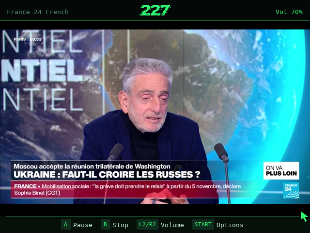
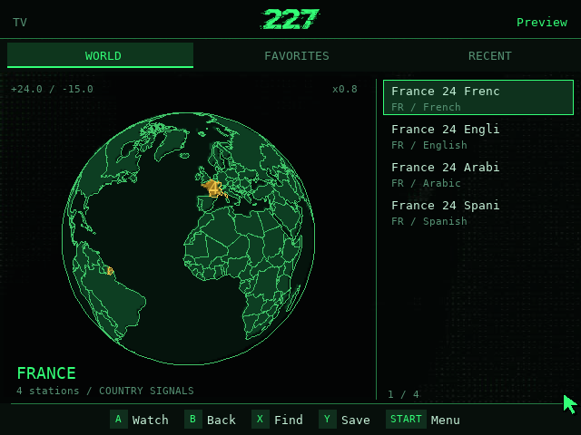
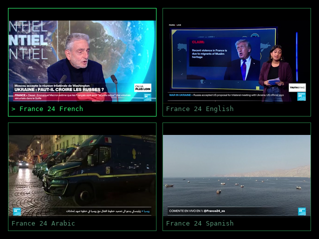
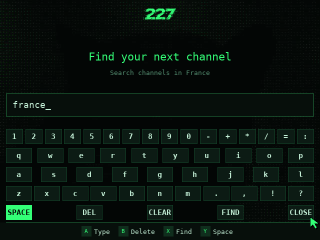
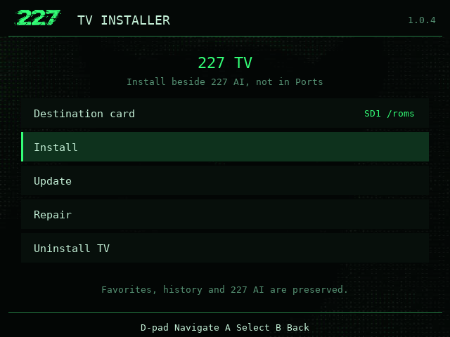

# 227 TV for R36S

**Live TV on a globe.** A controller-first internet TV atlas: choose a country,
find a station, and watch fullscreen on your handheld. No app account, project
playback server, or 227 AI installation required.

**[Download Install 227 TV.sh](https://github.com/1Z99/r36s-tv/releases/latest/download/Install.227.TV.sh)**
| **[Project Website](https://1z99.github.io/r36s-tv/)**
| [User Guide](USER_GUIDE.md)
| [Screenshots](assets/readme/README.md)
| [All Releases](https://github.com/1Z99/r36s-tv/releases)

Real France 24 French playback, captured on a **PC**, not an R36S. This is not a
handheld performance or audio test. [Capture notes and broadcast rights](assets/readme/README.md#provenance).

## Easy Install

1. **Copy one file.** Power off the handheld, download
   [Install.227.TV.sh](https://github.com/1Z99/r36s-tv/releases/latest/download/Install.227.TV.sh),
   and put it in the games SD card's existing **`tools`** folder. You can rename
   it `Install 227 TV.sh`. Safely eject the card and put it back.
2. **Install from Tools.** Boot, connect to Wi-Fi, and open
   **Tools > Install 227 TV**. Choose **SD1** or **SD2**, select **Install**, and
   confirm. After success, reload/restart EmulationStation, then open **227 > 227 TV**.

**TV creates the 227 system automatically if it is absent.** An existing shared
227 registration and other apps are preserved; choose its card if it already
exists. **227 AI is not required.** A Tools app launcher remains as a fallback.

Use the release installer, not a source ZIP or the repository's `install.sh`.
No SSH, terminal commands, or separate playback-engine download is needed on
supported firmware. Keep the device powered during installation. If your PC
cannot see the games partition, **do not format the card**.

[Full installation guide](INSTALLATION.md) covers compatibility, offline bundles,
card selection, logs, and recovery.

## Compatibility

| Item | Supported Target |
| --- | --- |
| Device | R36S, 640 x 480 display, aarch64 / ARM64 |
| Firmware | **dArkOSRE based on Debian 13 (trixie)** |
| Recorded hardware environment | Build `03082026`, kernel `4.4.189` |
| Storage | Writable games card mounted at `/roms` or `/roms2` |
| Network | Internet for installation, new channel lists, and live TV |

**Not a generic ArkOS package.** Original Ubuntu-based ArkOS, AmberELEC,
32-bit images, and untested clones are not supported by the shipped binaries.
The installer reuses working firmware libraries and rejects unsafe dependency
changes instead of replacing graphics drivers. [Detailed requirements](INSTALLATION.md#supported-handheld).

## First Channel

The initial World list says **Choose a country** by design. TV does not download
a worldwide channel catalog at startup.

1. Press **Start > Browse countries**, select a country, and confirm with **A**.
2. Wait for its list, select a station with Up/Down, and press **A** to watch.
   Try another station if a broadcaster is unavailable.
3. During playback, **A** pauses/resumes and **L2 / R2** changes volume.
   **B** dismisses an open menu first; from the watch view it stops playback.

**X** searches the loaded country list, not the whole world. **Y** toggles a
favorite while browsing. See the [user guide](USER_GUIDE.md) for search, matrix,
quality, and saved data.

## Features

- **Explore by country:** rotating globe, country fly-to, zoom, pointer controls,
  and on-demand country playlists with a 24-hour cache.
- **Keep your stations:** Favorites and Recent open from saved snapshots;
  search filters the loaded list locally.
- **Watch in the app:** fullscreen software-rendered libmpv playback with audio,
  automatic source selection, and broadcaster-provided resolution/FPS choices.
- **Four-view matrix:** up to four independent players with focused audio.
  **Experimental**, not a promise of four smooth live streams.
- **Make it yours:** green 227 interface, animated intro, globe detail and idle
  rotation settings, plus optional CRT effects.
- **Maintain from Tools:** Install, Update, Repair, and Uninstall TV, with saved
  data kept separate from the managed program.

Auto prefers sources up to **480p** for one channel and **240p** in matrix.
These are soft selection targets: HD-only streams still play with a warning.
TV does not transcode, and scaling does not remove HD decoding cost. Station
availability and regional access depend on the broadcaster.

## Preview

| World Atlas | Experimental Matrix |
| --- | --- |
|  |  |
| Scripted browser state, not a downloaded world catalog. | Real PC decoding of four language feeds, not a handheld benchmark. |

| Country-Scoped Search | Installation Manager |
| --- | --- |
|  |  |
| Local filtering over the scripted France list. | Production manager UI with sample cards; nothing installed. |

[Screenshot gallery and provenance](assets/readme/README.md) explains the five
images here and links all nine website views. Broadcast frames and station marks
belong to France 24 / France Medias Monde and the respective rights holders,
**not the project's MIT license**.

## Controls

| Control | Browsing | Playback |
| --- | --- | --- |
| A | Select station/country; activate pointer target | Pause/resume; with pointer in matrix, select a cell |
| B | Clear country/search filters, then exit prompt | Dismiss menu first; otherwise stop all playback |
| D-pad | Navigate/page list, or rotate in globe focus | Move matrix focus |
| Left stick | Pointer; hold A over globe to drag | Pointer |
| Right stick, vertical | Scroll list / browsing menu | No playback-menu scrolling |
| L1 / R1 | Previous / next tab | Previous / next matrix cell |
| L2 / R2 | Zoom out / in | Volume down / up |
| X / Y | Search / favorite | Not active |
| Select | Toggle globe / list focus | Not active |
| Start / FN | Open menu | Open menu without stopping playback |
| L3 / R3 | Random station from filtered list / no player to pause | L3 inactive / pause focused player |

Buttons are contextual. [Full controls and search keyboard](USER_GUIDE.md#controls).

## Updates And Removal

Close TV, then reopen **Tools > Install 227 TV** and choose its installed card.
**Update** checks for a newer stable release in normal online mode; an equal
version is not an installed-file integrity check. Use **Repair** for missing or
changed files or a lost TV menu entry. Repair restores the installed version;
offline recovery needs its release record and matching verified caches.

**Uninstall TV** preserves home-directory favorites, history, and preferences,
along with 227 AI and the shared 227 system. Back up
`~/.local/share/melkor227-tv/state.json` with TV closed before maintenance.
The installer does not restart EmulationStation for you.

[Maintenance and offline limits](INSTALLATION.md#update-and-remove)
| [Release notes for v1.0.4](RELEASE_NOTES.md)

## Help

[Installation and troubleshooting](INSTALLATION.md#logs-and-troubleshooting)
| [User guide](USER_GUIDE.md)
| [Report a problem](https://github.com/1Z99/r36s-tv/issues)

Include firmware/build, architecture, card choice, installed version, action,
exact error, and relevant log excerpts. Remove private paths and stream URLs.
Early failures: `~/.local/state/melkor227-tv/bootstrap.log`; manager:
`~/.local/state/melkor227-tv/installer.log`; app:
`~/.local/share/melkor227-tv/app.log`.

The [verification record](DEVELOPMENT.md#verification-record) distinguishes the
October 19 hardware run from the October 21 host audit: **366 tests ran, OK with
one skip**. PC screenshots are not additional hardware acceptance.

## Source And Credits

Maintained by **1Z99**, adapting the Melkor 227 desktop atlas. Thanks to
**southoz and the [dArkOSRE-R36 contributors](https://github.com/southoz/dArkOSRE-R36)**
for the separately installed firmware used in development.

[Development](DEVELOPMENT.md) covers architecture, local previews, runtime builds,
and tests. [Publishing](PUBLISHING.md) documents release assembly.

Application sources retain their MIT notices in [LICENSE](LICENSE) and
[assets/AI-LICENSE](assets/AI-LICENSE). **The complete distribution is not
MIT-only:** the GPL-enabled playback runtime and fonts have separate terms.
See [CREDITS.md](CREDITS.md) and the [screenshot rights notice](assets/readme/NOTICE.md).
No broadcast media ships in the application bundle; documentation screenshots
include broadcast frames. A public playlist is not permission to rebroadcast
content or bypass regional restrictions. Use streams only where authorized.
